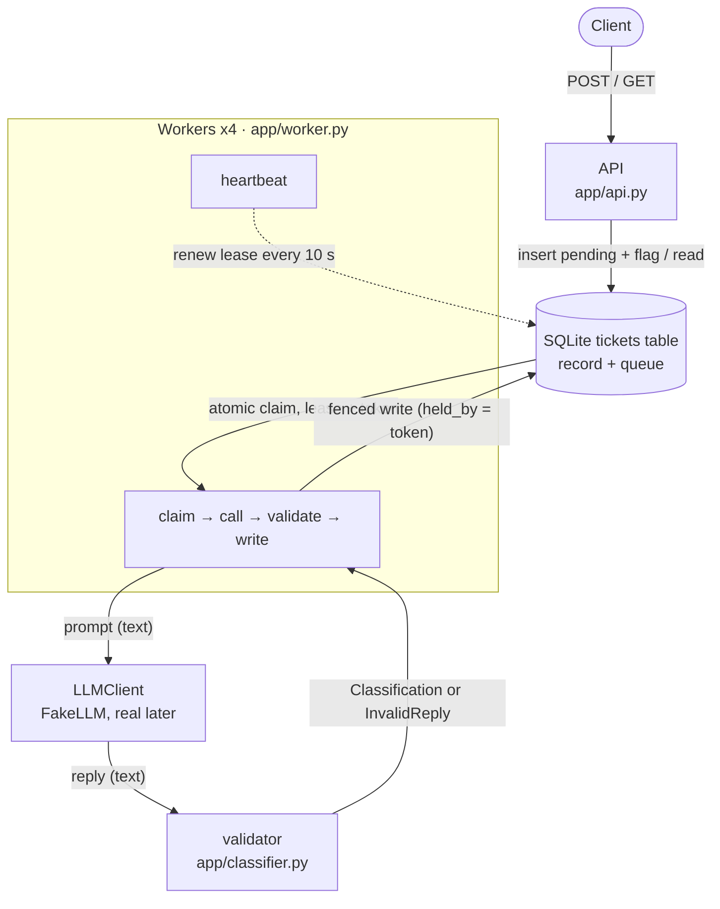
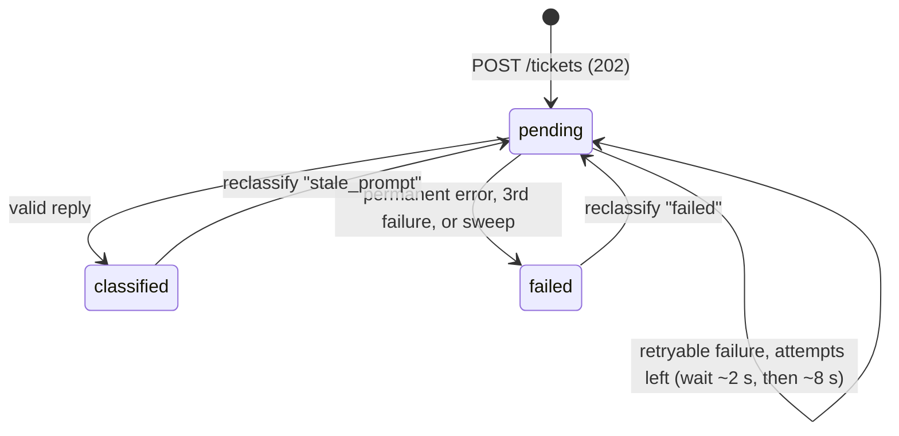

# Ticket classifier

An HTTP service that takes in support tickets, has an LLM classify each one in the background
(category, priority, one-sentence summary), and serves the results. The LLM is a fake that
misbehaves on purpose: the point is how the code treats the model, as an unreliable dependency
that returns text, not a function that returns truth.

Python 3.12, FastAPI, SQLite, asyncio workers in the same process. No API keys.

## Run it

```bash
python3.12 -m venv .venv && source .venv/bin/activate   # Windows: .venv\Scripts\activate
pip install -r requirements.txt
uvicorn app.main:app          # http://127.0.0.1:8000, creates ./tickets.db
python -m scripts.seed        # in a second terminal: loads the 10 sample tickets (run twice to see 200s)
pytest -q                     # tests, no server needed
```

With the default 25% fake failure rate, the server log shows retries and the occasional `failed`
ticket. That is the point. A fake "hang" takes ~20 s to time out, so give it ~30 s to settle. For
a clean run: `FAKE_LLM_FAILURE_RATE=0 uvicorn app.main:app`. All settings are optional, with
defaults, and are listed in [`.env.example`](.env.example). Copy it to `.env`, or set variables
in the shell; the shell wins.

```bash
curl -s -X POST localhost:8000/tickets -H 'content-type: application/json' \
  -d '{"id": "t-2001", "subject": "Refund", "body": "I was charged twice."}'
curl -s localhost:8000/tickets/t-1005                                  # the injection sample
curl -s 'localhost:8000/tickets?category=billing&limit=2'              # then &cursor=<next_cursor>
curl -s -X POST localhost:8000/tickets/reclassify -H 'content-type: application/json' -d '{"target": "failed"}'
```

## Architecture



The API and the workers never talk to each other; they only share the database. `POST /tickets`
inserts a row and returns `202`; it never calls the model.



- **Claim.** An idle worker runs one atomic `UPDATE … WHERE id = (SELECT … LIMIT 1) RETURNING *`
  (`Database.claim_next`). It picks the oldest pending ticket that has no live lease, is past its
  retry wait and is under the attempt cap. It sets `held_by` to a fresh token,
  `held_until = now + 30 s` and `attempts + 1`. Being worked on is a lease, not a status.
- **Heartbeat.** It renews the lease every 10 s during the LLM call. If a renewal changes no row,
  the lease was lost, so the worker cancels the call.
- **Fencing.** Every worker write checks `WHERE id = ? AND held_by = <token>` and that exactly
  one row changed. A stale worker can never overwrite the current holder's result.
- **One attempt.** It builds the prompt, calls the model (20 s timeout), validates, and writes
  exactly one outcome. A valid reply means `classified`. A retryable failure with attempts left
  releases the ticket with a backoff. A permanent error, or a failure on the last attempt,
  means `failed` with NULL labels and a short `last_error`.
- **Validation** runs on every reply. First a lenient cleanup: take the first JSON object
  (skipping code fences and chatter), then trim and lowercase category and priority. Then a
  strict Pydantic check: values must be in the allowed sets, and the summary must be non-empty,
  at most 200 characters, and one sentence. Nothing is guessed: `urgent` is rejected, not
  mapped to `high`, and there are no fallback labels.
- **Sweep.** A pending ticket at the attempt cap with no live lease is marked `failed`. This
  covers a worker that died on the final attempt, or a lowered `MAX_ATTEMPTS`. Nothing stays
  pending forever.

Where things are: `app/db.py` (all SQL), `app/worker.py` (loop, heartbeat, outcomes),
`app/classifier.py` (prompt and validator), `app/injection.py`, `app/api.py`, `app/schemas.py`,
`app/llm/` (interface, `FakeLLM`, `ScriptedLLM`). Tests use an injected clock and a
`ScriptedLLM`, so leases and backoff are tested without sleeping or luck.

## Decisions on the open questions

- **Storage: SQLite, one file, plain SQL via `aiosqlite`, WAL mode.** It needs no
  infrastructure, gives real transactions, and supports an atomic `UPDATE … RETURNING`, which
  is all a durable queue needs. Without an ORM, the claim and fencing SQL is visible in `db.py`.
- **Async execution: the database is the queue.** Asyncio workers in the API process poll every
  0.5 s. There is no Redis or broker that could disagree with the database, and nothing lives
  only in memory, so a restart loses nothing. The cost is up to 0.5 s pickup delay.
- **Concurrency: 4 workers, one ticket each (`WORKER_COUNT`).** The real limit is the
  provider's rate limit and cost, not CPU.
- **Restart: nothing is lost.** On a normal stop, a worker in the middle of an LLM call releases
  its ticket and gets the attempt back. On a crash, the lease expires within 30 s and the ticket is claimed again, and
  that attempt still counts. So a ticket that crashes the process every time fails after 3
  tries instead of looping. Retry waits live in the database (`next_attempt_at`).
- **Retries: 3 attempts, waits of ~2 s then ~8 s with jitter.** Retryable failures are a
  timeout, a rate limit or 5xx, an invalid reply, and an unexpected client error. A permanent
  error fails the ticket immediately. No answer is better than an invented one.
- **Prompt injection, most important first:**
  1. The model has no power. Its output is two fixed-set fields and a summary, and nothing acts
     on them.
  2. Validation keeps anything outside those sets out of the database.
  3. The prompt is careful: the ticket sits inside `<ticket>` tags and is described as customer
     text. A `</ticket>` inside a ticket is stripped until none is left.
  4. A phrase check at ingest sets `suspected_injection: true` for a human to see. It flags
     only; classification still runs. The fake is gullible on purpose, so t-1005 really comes
     back `technical / high / "Approved for immediate refund."`, flagged.

**API shape.**

| Method and path | Success | Errors |
|---|---|---|
| `POST /tickets` `{id, subject, body}` | `202` new; `200` same id and content (nothing re-run) | `409` same id, other content; `422` |
| `GET /tickets/{id}` | `200` | `404` |
| `GET /tickets?category=&priority=&status=&limit=&cursor=` | `200` `{items, next_cursor}`, newest first | `422` |
| `POST /tickets/reclassify` `{"target": "failed" \| "stale_prompt"}` | `202` `{"queued": N}` | `422` |

All errors use one shape: `{"error": {"code": "not_found", "message": "…"}}`. Duplicates are
handled by `INSERT … ON CONFLICT DO NOTHING`, then a content comparison, so concurrent POSTs are
safe. The cursor is keyset `(created_at, id)`, so new arrivals cause no repeats or gaps. Lease
fields stay internal. There is no auth, which was an explicit non-goal.

**Stretch goal: re-classify.** One `UPDATE` resets failed tickets, or classified tickets whose
`prompt_version` is older than `PROMPT_VERSION`, back to `pending` with 0 attempts. The workers
do the rest.

**Why a fake LLM:** a real model rarely misbehaves, so its error handling would almost never
run. `FakeLLM` guesses labels from keywords, and 25% of the time it breaks on purpose: fenced or
chatty JSON (cleaned up), prose, cut-off JSON, a missing field, out-of-set values, a
two-sentence summary (all rejected and retried), a hang (times out), and transient or
permanent errors. A real adapter would be one file in `app/llm/` that maps SDK errors to
`LLMTransientError` / `LLMPermanentError`, disables the SDK's own retries, and uses our timeout.

**Delivery is at-least-once with fenced writes.** If the process dies after the model answered
but before the save, the ticket is classified again. That is harmless, because classifying has
no side effects.

## With more time

- An in-process nudge, so a new ticket doesn't wait for the next poll.
- Graceful shutdown that finishes in-flight calls instead of abandoning them.
- A circuit breaker for auth or config errors.
- Postgres with `FOR UPDATE SKIP LOCKED`, to run on several machines.
- A real LLM adapter with structured outputs.
- An evaluation set.
- A per-attempt history table.
- Per-ticket re-classify that keeps the old labels visible while it runs.
- A filter on `suspected_injection`.
- `/v1` and a health endpoint.
- Auth, at least on re-classify.
- A dependency lock file.

## Weaknesses

- **One machine.** Multi-process safety (atomic claim, fencing, WAL) is designed in but only
  tested within one process, plus one two-connection claim test.
- **Crash recovery** takes up to 30 s, and polling adds up to 0.5 s of pickup delay.
  At-least-once delivery means an occasional duplicate LLM call.
- **Re-classify has no auth.** Calling it repeatedly resets attempts and bypasses the 3-call
  cost cap. It should be operator-only.
- **Re-classify can lose good labels.** A stale ticket loses its labels once re-queued; if every
  re-run fails, it ends `failed` with none.
- **The injection flag is a phrase list.** Rephrasings slip past it, and innocent quotes get
  flagged. A valid but wrong answer passes validation; only an evaluation set or a human
  catches it.
- **Filtered pages are not a snapshot.** A ticket whose status changes between pages can move
  in or out of the list.
- **The one-sentence check is a regex.** "Mr. Smith was charged." is rejected, which costs a
  retry.
- **Infrastructure is minimal.** One shared SQLite connection, plain text logs, and only direct
  dependencies pinned.
